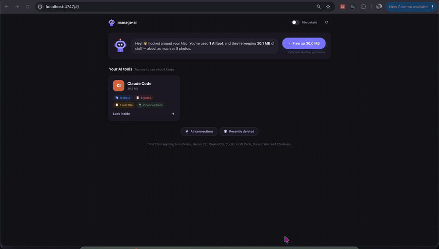
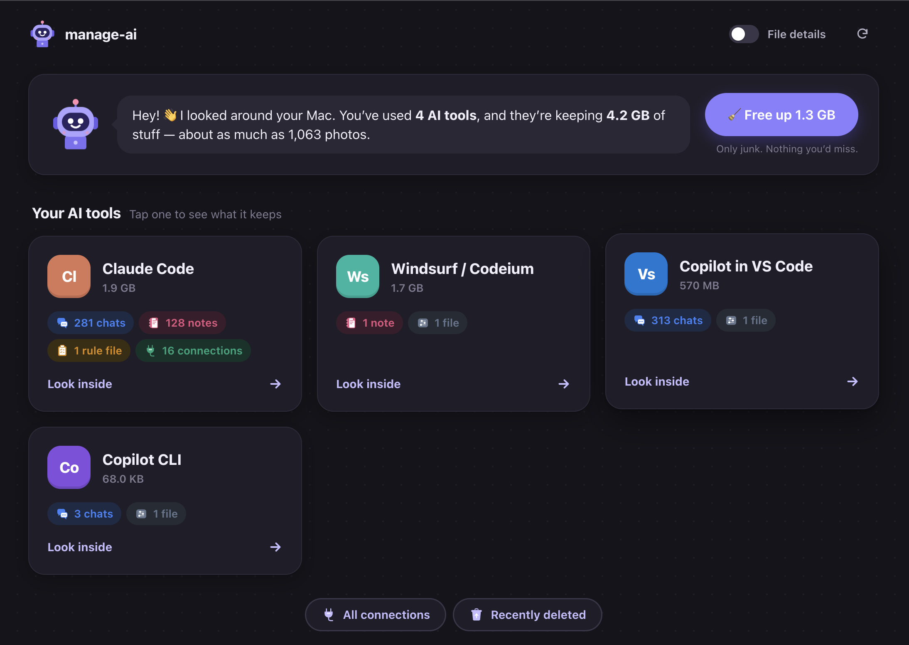
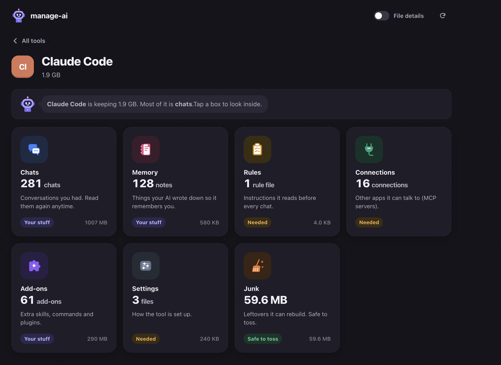

# manage-ai

**Your AI has been taking notes on you. Ever checked what it kept?**

You've been living in Claude Code, Codex, Copilot, Cursor. Juggling agents, spinning up worktrees, jumping between tickets. Every session left something behind: chats you'll never reopen, memories about projects you shipped months ago, rules written for a codebase that no longer exists, MCP servers you forgot you connected.

It all still loads. It all still steers your AI. And it's been piling up since day one.

**manage-ai is the one-stop shop for everything your AI tools saved on your machine.** See it, read it, edit it, and clear out the stale stuff — chats, memory, rules, settings, MCP connections, skills, plugins and caches.

Runs locally. Nothing leaves your machine.



▶️ [Watch in full quality](docs/demo.mp4)

| Home | Inside a tool |
| --- | --- |
|  |  |

## Run

```sh
npx manage-ai
```

Opens http://localhost:4747 in your browser. Options: `--port 5000`, `--no-open`.

macOS only for now.

### From source

```sh
npm install
npm start
```

### Demo mode

```sh
npm run demo
```

Fills a fake home folder (`/tmp/manage-ai-demo`) with made-up chats, memory and junk from every tool, then runs manage-ai on it. Your real files aren't touched, so it's safe for screenshots, videos and trying deletes.

## Supports

Claude Code · Codex · Gemini CLI · Copilot CLI · Copilot in VS Code · Cursor · Windsurf/Codeium

Tool definitions live in `server/tools.js` — add a tool by adding an entry.

## Safety

- Listens on `127.0.0.1` only. Nothing leaves your machine.
- Only touches files inside known AI tool folders.
- Deletes go to the macOS Trash (`~/.Trash/manage-ai`) with one-click undo.
- Edits back up the old file to `~/.manage-ai/backups` first.
- Login tokens are hidden until you click Reveal.

## Stack

Node + Hono (server) · Preact + htm (UI, no build step) · 3 dependencies.
